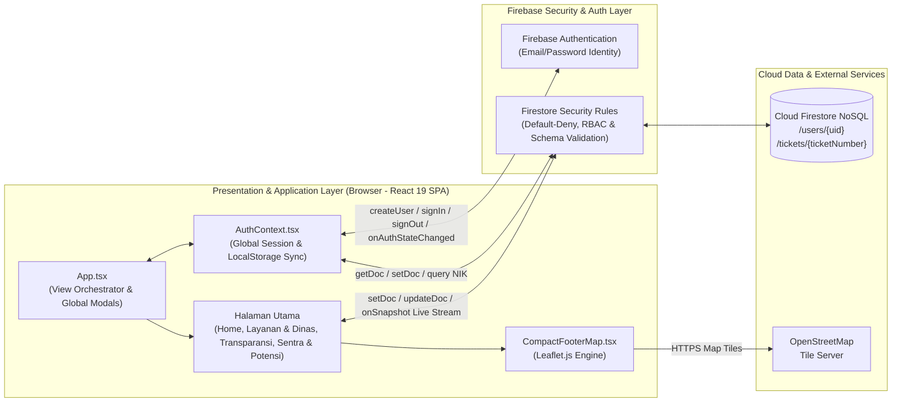
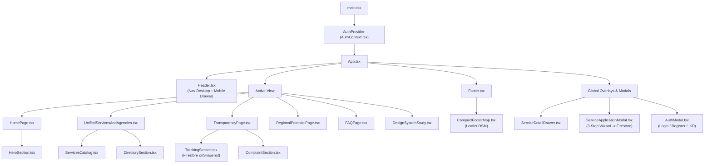
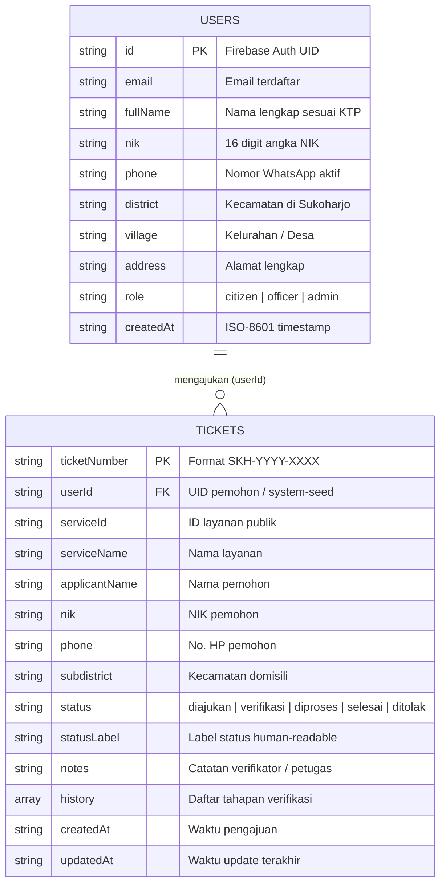
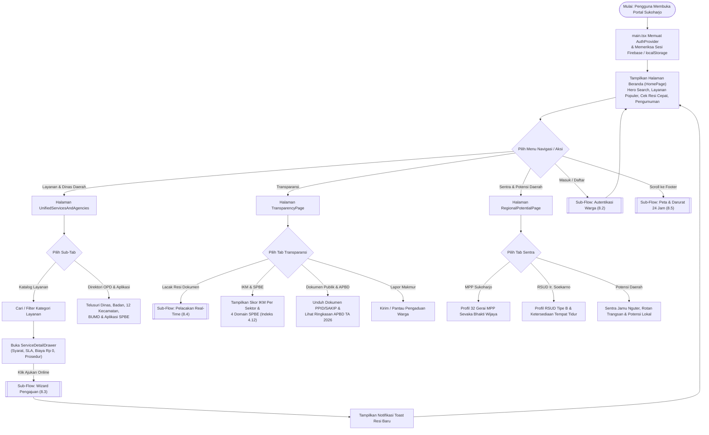
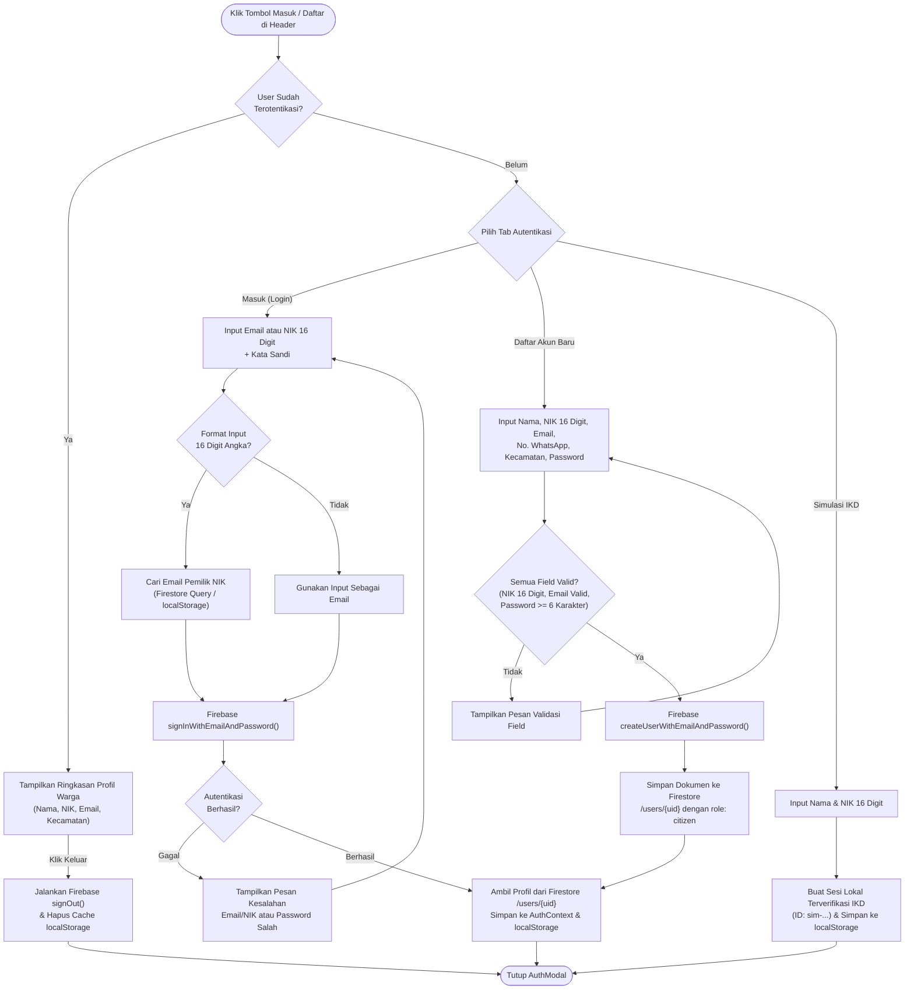
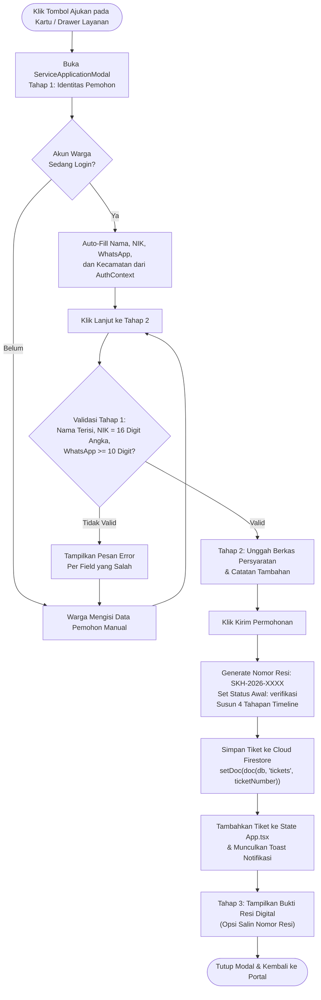
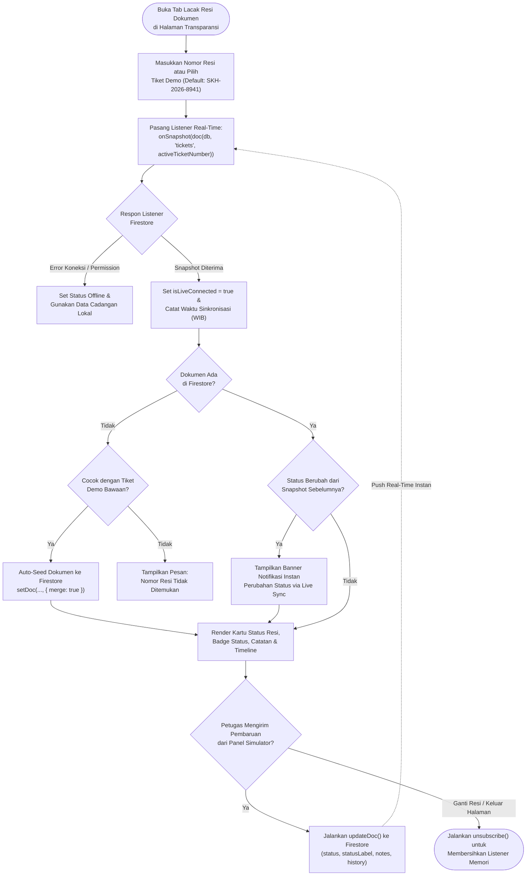
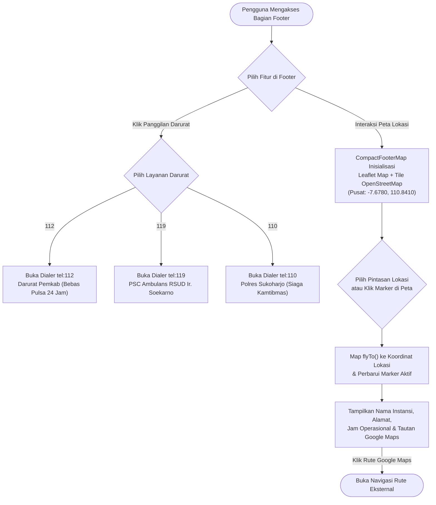

# Portal Layanan Publik Terpadu Kabupaten Sukoharjo

> **Portal Layanan Publik Terpadu Kabupaten Sukoharjo** adalah aplikasi web pemerintahan modern (*Single Portal*) berbasis standar nasional **INA Digital Design System (IDDS)** untuk ekosistem **SPBE (Sistem Pemerintahan Berbasis Elektronik) Kabupaten Sukoharjo Makmur**. Portal ini menyatukan akses katalog layanan publik (Rp 0 tanpa calo), direktori instansi & 12 kecamatan, pengajuan berkas daring, pelacakan status permohonan *real-time*, transparansi kinerja (IKM, SPBE, APBD), sentra pelayanan & potensi daerah, serta peta lokasi interaktif dan panggilan darurat 24 jam.


---

## Daftar Isi

1. [Gambaran Umum & Fitur Utama](#1-gambaran-umum--fitur-utama)
2. [Bahasa Pemrograman yang Dipakai](#2-bahasa-pemrograman-yang-dipakai)
3. [Stack Teknologi & Pustaka (*Tech Stack*)](#3-stack-teknologi--pustaka-tech-stack)
4. [Metode, Standar Desain, & Pendekatan Pengembangan](#4-metode-standar-desain--pendekatan-pengembangan)
5. [Arsitektur Sistem & Pola Perangkat Lunak](#5-arsitektur-sistem--pola-perangkat-lunak)
6. [Struktur Kode & Penjelasan Detail Modul](#6-struktur-kode--penjelasan-detail-modul)
7. [Skema Basis Data (ERD) & Aturan Keamanan Firestore](#7-skema-basis-data-erd--aturan-keamanan-firestore)
8. [Flowchart Sistem Lengkap](#8-flowchart-sistem-lengkap)
   - [8.1 Flowchart Utama Navigasi Portal (*End-to-End*)](#81-flowchart-utama-navigasi-portal-end-to-end)
   - [8.2 Flowchart Autentikasi Warga (Registrasi, Login Email/NIK, IKD & Logout)](#82-flowchart-autentikasi-warga-registrasi-login-emailnik-ikd--logout)
   - [8.3 Flowchart Pengajuan Layanan Publik Online (Wizard 3 Tahap)](#83-flowchart-pengajuan-layanan-publik-online-wizard-3-tahap)
   - [8.4 Flowchart Pelacakan Status Permohonan Real-Time (*Firestore Live Sync*)](#84-flowchart-pelacakan-status-permohonan-real-time-firestore-live-sync)
   - [8.5 Flowchart Peta Interaktif & Panggilan Darurat 24 Jam](#85-flowchart-peta-interaktif--panggilan-darurat-24-jam)
9. [Panduan Instalasi & Menjalankan di Lokal](#9-panduan-instalasi--menjalankan-di-lokal)
10. [Daftar Perintah NPM (*Scripts*) & Build Produksi](#10-daftar-perintah-npm-scripts--build-produksi)
11. [Verifikasi Kualitas Kode, Aksesibilitas, & *Troubleshooting*](#11-verifikasi-kualitas-kode-aksesibilitas--troubleshooting)

---

## 1. Gambaran Umum & Fitur Utama

Portal ini dikembangkan untuk menjawab kebutuhan masyarakat akan layanan pemerintahan yang cepat, mudah dipahami, transparan, dan terintegrasi dalam satu pintu digital.

### Modul & Fitur Utama:
1. **Beranda Terpadu & Pencarian Pintar (*Smart Citizen Search*)**
   - Bilah pencarian global dengan pintasan kata kunci populer (*KTP Elektronik*, *e-PBB Sukoharjo*, *RSUD Ir. Soekarno*, *Izin Usaha UMKM*, *PRASOJO Adminduk*).
   - Akses kilat 4 layanan prioritas warga dan *Proof Strip* akuntabilitas (12 Kecamatan Terpadu, 100% Bebas Pungli Rp 0, IKM 98.4%, Rata-rata Respon SLA `< 24 Jam`).
   - Cek progres resi cepat langsung dari halaman Beranda serta papan pengumuman kebijakan daerah terkini.
2. **Katalog Layanan & Direktori Dinas Daerah (OPD)**
   - **Katalog Layanan:** Pengelompokan layanan berdasarkan siklus hidup (Kependudukan, Kesehatan, Pajak, Perizinan, Sosial, Ketenagakerjaan, UMKM & Pertanian).
   - **Drawer Detail Layanan:** Informasi syarat dokumen, langkah prosedur, estimasi SLA, dan biaya resmi tanpa harus meninggalkan halaman.
   - **Wizard Pengajuan Online (3 Tahap):** Formulir pengajuan layanan terintegrasi dengan data profil warga (*auto-fill*) yang langsung menyimpan tiket ke Cloud Firestore dan menerbitkan nomor resi resmi (`SKH-2026-XXXX`).
   - **Direktori Instansi & Ekosistem Aplikasi:** Daftar lengkap Dinas Daerah, Badan, Bagian Setda, Instansi Vertikal (Polres, KPP Pratama, ATR/BPN), BUMD, 12 Kantor Kecamatan, dan tautan aplikasi digital Sukoharjo.
3. **Transparansi Publik & Pelacakan Real-Time**
   - **Lacak Resi Dokumen Live:** Pelacakan status permohonan secara *real-time* menggunakan listener Cloud Firestore (`onSnapshot`), lengkap dengan *stepper timeline*, indikator koneksi *live*, notifikasi instan perubahan status, serta **Panel Simulator Petugas** untuk menguji pembaruan status secara langsung.
   - **Indeks Kepuasan Masyarakat (IKM) & SPBE:** Rincian skor kepuasan per unit layanan dan domain evaluasi SPBE KemenPAN-RB (Indeks `4.12`).
   - **Dokumen Publik & Ringkasan APBD TA 2026:** Daftar dokumen PPID/SAKIP/LPPD yang dapat diunduh serta ringkasan postur pendapatan dan belanja daerah.
   - **Pengaduan Warga (*Lapor Makmur*):** Kanal penyampaian laporan dan aspirasi masyarakat.
4. **Sentra Pelayanan & Potensi Daerah**
   - Profil **Mal Pelayanan Publik (MPP) Sevaka Bhakti Wijaya** dengan daftar 32 gerai terintegrasi dan fasilitas ramah disabilitas.
   - Profil **RSUD Ir. Soekarno Sukoharjo (Tipe B)** lengkap dengan tampilan ketersediaan tempat tidur rawat inap (*Bed Management*) per kelas kamar.
   - Profil potensi ekonomi & budaya unggulan daerah: **Sentra Jamu Nguter**, **Industri Mebel & Rotan Trangsan**, dan klaster kreatif Sukoharjo.
5. **Sistem Autentikasi Warga (INA Pass / SSO)**
   - Registrasi akun warga baru dengan validasi NIK 16 digit, email, nomor WhatsApp, dan kecamatan domisili.
   - Login fleksibel menggunakan **Email atau NIK 16 digit** dan fitur simulasi masuk cepat **IKD (Identitas Kependudukan Digital)**.
6. **Peta Lokasi Interaktif & Panggilan Darurat 24 Jam**
   - Peta geografis berbasis **Leaflet.js + OpenStreetMap** di bagian Footer dengan pin lokasi berkode warna (MPP, RSUD, Menara Wijaya, Polres, dan 12 Kecamatan) serta pintasan rute Google Maps.
   - Tombol panggil cepat darurat 24 jam: **112 (Darurat Pemkab)**, **119 (PSC Ambulans RSUD)**, dan **110 (Polres Sukoharjo)**.

---

## 2. Bahasa Pemrograman yang Dipakai

Proyek ini menggunakan kombinasi beberapa bahasa pemrograman dan bahasa deklaratif yang saling terintegrasi:

| No | Bahasa | Ekstensi File | Peran & Kegunaan dalam Proyek |
| :---: | :--- | :--- | :--- |
| 1 | **TypeScript** | `.ts`, `.tsx` | Bahasa pemrograman utama untuk seluruh komponen UI React, logika bisnis, manajemen state (`AuthContext`), koneksi Firebase, dan definisi tipe data statis (`src/types.ts`) guna mencegah *runtime error*. |
| 2 | **JSX / TSX** | `.tsx` | Sintaks deklaratif antarmuka komponen React yang menggabungkan markup UI dengan ekspresi TypeScript secara *type-safe*. |
| 3 | **HTML5** | `.html` | Dokumen titik masuk aplikasi (`index.html`), pengaturan metadata SEO/OpenGraph, pemuatan Google Fonts (`Inter`, `Plus Jakarta Sans`, `JetBrains Mono`), dan *favicon* resmi Lambang Kabupaten Sukoharjo. |
| 4 | **CSS3 & Tailwind CSS v4** | `.css` | Pengaturan tata letak responsif, tema warna institusional, dukungan mode gelap (`@custom-variant dark`), token IDDS (`@idds/styles`), dan animasi transisi halaman (`@keyframes fadeInPage`). |
| 5 | **Firestore Security Rules DSL** | `.rules` | Bahasa aturan keamanan deklaratif di sisi server Google Cloud Firestore (`firestore.rules`) untuk validasi tipe data, pola regex NIK 16 digit, dan pembatasan hak akses (*RBAC*). |
| 6 | **JSON** | `.json` | Konfigurasi proyek & dependensi (`package.json`, `tsconfig.json`), metadata aplikasi (`metadata.json`), konfigurasi Firebase (`firebase-applet-config.json`), dan cetak biru skema entitas (`firebase-blueprint.json`). |

---

## 3. Stack Teknologi & Pustaka (*Tech Stack*)

| Kategori | Teknologi / Paket | Versi | Fungsi Utama |
| :--- | :--- | :--- | :--- |
| **Frontend Framework** | `react`, `react-dom` | `^19.0.1` | Membangun *Single Page Application* (SPA) berbasis komponen fungsional & React Hooks. |
| **Type System** | `typescript`, `@types/react`, `@types/react-dom`, `@types/node` | `^7.0.2` | Pemeriksaan tipe statis menyeluruh (`tsc --noEmit`). |
| **Build Tool & Bundler** | `vite`, `@vitejs/plugin-react` | `^8.3.0` | *Development server* cepat di port `3000` dan bundling produksi optimal. |
| **Styling Engine** | `tailwindcss`, `@tailwindcss/vite`, `autoprefixer` | `^4.3.3` | Framework CSS *utility-first* generasi v4 terintegrasi langsung dengan Vite. |
| **Design System** | `@idds/styles` | `^1.6.38` | Paket gaya & token warna resmi **INA Digital Design System (GovTech Indonesia)**. |
| **Cloud Backend (BaaS)** | `firebase` (Authentication & Cloud Firestore) | `^13.1.0` | Otentikasi akun warga dan basis data NoSQL *real-time* di cloud. |
| **Pemetaan (GIS)** | `leaflet`, `@types/leaflet` | `^1.9.4` | Peta interaktif sebaran lokasi pelayanan publik berbasis tile OpenStreetMap. |
| **Ikonografi** | `lucide-react` | `^0.546.0` | Pustaka ikon SVG modern yang tajam, konsisten, dan ringan. |
| **Animasi** | `motion` | `^12.23.24` | Dukungan animasi transisi UI yang halus. |
| **Server / Tooling Tambahan** | `express`, `tsx`, `dotenv` | `^4.21.2` | Kesiapan integrasi *backend proxy* Node.js apabila diperlukan ekstensi API server-side. |

---

## 4. Metode, Standar Desain, & Pendekatan Pengembangan

### A. Metodologi Pengembangan Perangkat Lunak
1. **Agile / Iterative Development:**
   Pengembangan dilakukan melalui siklus iterasi pendek yang terukur:
   - *Analisis Kebutuhan & Pemetaan Layanan:* Mengidentifikasi kebutuhan utama warga Sukoharjo (Adminduk, Kesehatan, Pajak, Perizinan, Transparansi).
   - *Perancangan Sistem & Token Desain:* Menerapkan pedoman INA Digital Design System ke dalam utilitas Tailwind CSS.
   - *Implementasi Modular Bertahap:* Membangun modul per modul (Beranda $\rightarrow$ Katalog & Direktori $\rightarrow$ Autentikasi $\rightarrow$ Pengajuan & Pelacakan Real-Time $\rightarrow$ Peta & Potensi Daerah).
   - *Evaluasi, Perbaikan & Verifikasi:* Audit tipe TypeScript (`npm run lint`), uji build produksi (`npm run build`), dan uji responsivitas lintas ukuran layar.
2. **Component-Driven Development (CDD):**
   Antarmuka dipecah menjadi komponen kecil yang independen, dapat digunakan ulang (*reusable*), dan memiliki kontrak properti (*TypeScript interfaces*) yang tegas.
3. **User-Centered Design (UCD) & UX Writing Pemerintahan:**
   - Menghindari jargon birokrasi/hukum yang membingungkan warga awam.
   - Menampilkan kepastian layanan di baris depan: **Estimasi SLA**, **Biaya Resmi (Rp 0)**, dan **Syarat Dokumen** secara lugas.

### B. Standar Desain Antarmuka (INA Digital Design System / IDDS)
- **Zero-Pill Discipline:** Menghindari penggunaan *badge/pill* membulat berlebihan pada label informasi demi menjaga tampilan antarmuka pemerintahan yang bersih, formal, dan berwibawa.
- **Identitas Resmi Daerah:** Penempatan lambang resmi Kabupaten Sukoharjo (`Seal_of_Sukoharjo_Regency`) secara konsisten di Header, Footer, Modal Autentikasi, dan Favicon browser.
- **Strategi Tata Letak Responsif Adaptif:**
  - **Header / Navigasi:** Pada layar desktop (`>= md`) menampilkan 4 tautan horizontal rapi (*Beranda*, *Layanan & Dinas Daerah*, *Transparansi*, *Sentra & Potensi Daerah*). Saat layar mengecil atau jendela diminimalkan (*minimized*), navigasi otomatis bertransisi menjadi tombol menu *hamburger* dengan *dropdown drawer* yang bersih.
  - **Konten Utama:** Menggunakan grid responsif (`grid-cols-1 md:grid-cols-2 lg:grid-cols-3` dan `lg:grid-cols-12`) agar teks, kartu layanan, dan formulir nyaman dibaca di berbagai ukuran layar.
  - **Footer Institusi:** Mempertahankan komposisi 4 kolom identik dengan tampilan *fullscreen* (`grid-cols-12`, `min-w-[1100px]`, dengan `overflow-x-auto`) agar struktur logo, panggilan darurat 24 jam, navigasi, kontak, dan peta lokasi tidak berubah susunannya saat jendela diminimalkan.

---

## 5. Arsitektur Sistem & Pola Perangkat Lunak

### A. Klasifikasi Arsitektur
Proyek ini menggunakan arsitektur **Frontend-Dominant Full-Stack Single Page Application (SPA) + Serverless Backend-as-a-Service (BaaS)**:
- **Presentation & Application Layer (Client / Browser):** React 19 + TypeScript + Vite menangani rendering antarmuka, navigasi multi-halaman tanpa *reload*, validasi formulir, dan interaksi peta.
- **Identity & Data Layer (Cloud Serverless):** Google Firebase menyediakan **Firebase Authentication** (manajemen sesi & kredensial warga) serta **Cloud Firestore** (penyimpanan dokumen NoSQL dengan sinkronisasi *real-time*).
- **Security Layer (Server-Side Policy):** `firestore.rules` bertindak sebagai gerbang validasi di sisi server yang memverifikasi identitas (`request.auth`), kepemilikan dokumen, dan format skema data sebelum operasi tulis/baca diizinkan.
- **Geospatial Layer:** Leaflet.js mengambil *raster map tiles* secara langsung dari server **OpenStreetMap**.

### B. Diagram Arsitektur Sistem



### C. Pola Desain Perangkat Lunak (*Software Design Patterns*) yang Diterapkan
1. **Observer / Publish-Subscribe Pattern (`onSnapshot`):**
   Komponen `TrackingSection` berlangganan (*subscribe*) ke dokumen `/tickets/{ticketNumber}` di Cloud Firestore. Setiap kali status diubah (misalnya oleh petugas), Firestore mendorong (*push*) pembaruan secara instan ke UI pemohon beserta notifikasi banner perubahan status.
2. **Context Provider Pattern (`AuthContext`):**
   Menyediakan state sesi autentikasi dan fungsi (`register`, `login`, `loginWithSimulatedIKD`, `logout`) ke seluruh komponen turunan tanpa *prop drilling*.
3. **Container / Presentational Pattern:**
   Memisahkan komponen pengelola logika & data (`App.tsx`, `TrackingSection.tsx`, `ServiceApplicationModal.tsx`, `AuthModal.tsx`) dari komponen tampilan murni (`HeroSection.tsx`, `ServicesCatalog.tsx`, `Footer.tsx`).
4. **Client-Side State Routing:**
   Perpindahan antar halaman (`home`, `layanan-dinas`, `transparansi`, `sentra-potensi`, `faq`, `design-system`) dikelola melalui state `activeView` di `App.tsx` dengan transisi animasi `.animate-fade-in` yang instan tanpa jeda *reload* server.
5. **Graceful Fallback & Auto-Seeding Pattern:**
   - Saat tiket contoh belum ada di Firestore, `TrackingSection` otomatis menyemai (*auto-seed*) data awal ke Firestore (`setDoc(..., { merge: true })`).
   - Jika jaringan offline atau terjadi pembatasan izin, antarmuka tetap menampilkan data cadangan secara aman tanpa merusak pengalaman pengguna.

---

## 6. Struktur Kode & Penjelasan Detail Modul

### A. Pohon Direktori Proyek

```text
.
├── index.html                             # Entry HTML utama, font Google, metadata SEO & favicon resmi
├── metadata.json                          # Identitas & kapabilitas applet
├── package.json                           # Dependensi runtime, devDependencies & npm scripts
├── tsconfig.json                          # Konfigurasi TypeScript (ES2022, bundler resolution, react-jsx)
├── vite.config.ts                         # Konfigurasi Vite + plugin React & Tailwind CSS v4
├── firestore.rules                        # Aturan keamanan server-side Cloud Firestore
├── firebase-blueprint.json                # Cetak biru definisi entitas & koleksi Firestore
├── firebase-applet-config.json            # Konfigurasi proyek Firebase aktif
├── .env.example                           # Template variabel lingkungan
├── README.md                              # Dokumentasi teknis lengkap proyek
├── public/
│   └── assets/
│       ├── aistudio/
│       │   └── Seal_of_Sukoharjo_Regency.svg_ae6fd6b1.webp  # Lambang resmi Kabupaten Sukoharjo
│       └── images/
│           ├── hero_sukoharjo_civic_1791897665007.jpg       # Foto Alun-Alun & Pusat Pemerintahan
│           ├── service_hall_sukoharjo_1791897667864.jpg     # Foto Interior Mal Pelayanan Publik
│           ├── rsud_healthcare_service_1791897667542.jpg    # Foto Fasilitas RSUD Ir. Soekarno
│           └── sukoharjo_jamu_heritage_1791897667176.jpg    # Foto Sentra Jamu Nguter
└── src/
    ├── main.tsx                           # Bootstrap React DOM & pembungkus <AuthProvider>
    ├── App.tsx                            # Root komponen: state global, routing halaman, toast & modal
    ├── index.css                          # Entry CSS: @idds/styles, Tailwind v4, dark mode & animasi
    ├── types.ts                           # Definisi seluruh tipe & interface TypeScript terpusat
    ├── firebase.ts                        # Inisialisasi Firebase App, Auth, Firestore & error logger
    ├── vite-env.d.ts                      # Deklarasi tipe bawaan klien Vite
    ├── context/
    │   └── AuthContext.tsx                # Provider autentikasi warga (Firebase Auth + Firestore + localStorage)
    ├── data/
    │   └── mockData.ts                    # Master data layanan publik, OPD, 12 kecamatan, lokasi peta & tiket awal
    └── components/
        ├── Header.tsx                     # Navigasi utama responsif + mobile hamburger drawer
        ├── Footer.tsx                     # Footer institusi 4 kolom tetap + kontak darurat 112/119/110
        ├── CompactFooterMap.tsx           # Peta interaktif Leaflet.js + OpenStreetMap
        ├── HeroSection.tsx                # Banner hero, global search bar, akses kilat & proof strip
        ├── HomePage.tsx                   # Halaman Beranda utama
        ├── UnifiedServicesAndAgencies.tsx # Halaman Layanan & Dinas Daerah (segmented tab switcher)
        ├── ServicesCatalog.tsx            # Katalog layanan publik dengan pencarian & filter kategori
        ├── DirectorySection.tsx           # Direktori Dinas, Badan, Setda, Vertikal, BUMD, Kecamatan & Aplikasi
        ├── ServiceDetailDrawer.tsx        # Panel samping detail persyaratan, SLA, biaya & tahapan
        ├── ServiceApplicationModal.tsx    # Modal wizard 3 langkah pengajuan layanan online -> Firestore
        ├── TransparencyPage.tsx           # Halaman Transparansi (Lacak Resi, IKM/SPBE, Dokumen/APBD, Aduan)
        ├── TrackingSection.tsx            # Pelacakan resi real-time onSnapshot + Simulator Petugas
        ├── ComplaintSection.tsx           # Form & daftar pengaduan masyarakat Lapor Makmur
        ├── RegionalPotentialPage.tsx      # Halaman Sentra MPP, Bed Management RSUD & Potensi Daerah
        ├── RegionalShowcase.tsx           # Komponen ringkasan visual sentra pelayanan
        ├── FAQPage.tsx                    # Halaman Tanya Jawab (FAQ) layanan publik
        ├── DesignSystemStudy.tsx          # Dokumentasi interaktif token warna, tipografi & komponen IDDS
        └── AuthModal.tsx                  # Dialog autentikasi warga (Login, Registrasi, Simulasi IKD, Profil)
```

### B. Hirarki Komponen Aplikasi



### C. Ringkasan Peran File Inti
| File | Tanggung Jawab Utama |
| :--- | :--- |
| `src/types.ts` | Mendefinisikan kontrak tipe: `AppView`, `ServiceCategory`, `PublicService`, `ApplicationStatus`, `ApplicationTicket`, `ComplaintTicket`, `AgencyType`, `AgencyItem`, `LocationCategory`, `ServiceLocation`, dan `UserProfile`. |
| `src/firebase.ts` | Menginisialisasi instance tunggal Firebase (`initializeApp`), `getAuth`, dan `getFirestore` (mendukung named database ID dari `firebase-applet-config.json`), serta fungsi `handleFirestoreError()` untuk pencatatan galat terstruktur. |
| `src/context/AuthContext.tsx` | Mengelola `onAuthStateChanged`, sinkronisasi profil ke `/users/{uid}`, pencarian email berdasarkan NIK 16 digit saat login, sesi simulasi IKD (`sim-...`), serta cache sesi di `localStorage` (`sukoharjo_user_profile`). |
| `src/App.tsx` | Mengatur state halaman aktif (`activeView`), sub-tab layanan (`servicesTab`), kata kunci pencarian (`searchQuery`), daftar tiket lokal, notifikasi *toast*, serta membuka/menutup *drawer* dan *modal*. |
| `src/data/mockData.ts` | Menyediakan data awal terstruktur: 12 kecamatan Sukoharjo, katalog layanan publik, tiket contoh (`SKH-2026-8941`, `SKH-2026-7210`), daftar OPD & instansi vertikal, titik koordinat lokasi layanan (`[lat, lng]`), dan spesifikasi token IDDS. |

---

## 7. Skema Basis Data (ERD) & Aturan Keamanan Firestore

### A. Diagram Relasi Entitas (*Entity Relationship Diagram*)



### B. Matriks Aturan Keamanan (`firestore.rules`)

Basis data menerapkan prinsip ***Default-Deny*** (`match /{document=**} { allow read, write: if false; }`) dan hanya membuka akses spesifik yang tervalidasi:

| Koleksi | Operasi | Kebijakan Keamanan & Validasi |
| :--- | :---: | :--- |
| `/users/{userId}` | `get` | Hanya pengguna yang sudah login dan pemilik dokumen (`request.auth.uid == userId`). |
| `/users/{userId}` | `list` | **Ditolak (`false`)** untuk mencegah enumerasi atau kebocoran data NIK warga lain. |
| `/users/{userId}` | `create` | Terotentikasi, ID valid, `data.id == request.auth.uid`, `nik` cocok regex `^[0-9]{16}$`, dan `role` valid. |
| `/users/{userId}` | `update` | Pemilik dokumen valid, serta kolom `id` dan `role` tidak boleh dimodifikasi sendiri (*immutable role*). |
| `/users/{userId}` | `delete` | **Ditolak (`false`)**. |
| `/tickets/{ticketId}` | `get` | Diizinkan apabila `ticketId` berformat aman (`^[a-zA-Z0-9_\-]+$`, maks. 128 karakter) untuk pelacakan resi spesifik. |
| `/tickets/{ticketId}` | `list` | Hanya pengguna login dan hanya dokumen miliknya sendiri (`resource.data.userId == request.auth.uid`). |
| `/tickets/{ticketId}` | `create` / `update` | ID valid dan lolos `isValidTicket()` (validasi panjang string & enum `status` sah). |
| `/tickets/{ticketId}` | `delete` | **Ditolak (`false`)** demi integritas jejak audit pelayanan publik. |

---

## 8. Flowchart Sistem Lengkap

### 8.1 Flowchart Utama Navigasi Portal (*End-to-End*)



---

### 8.2 Flowchart Autentikasi Warga (Registrasi, Login Email/NIK, IKD & Logout)



---

### 8.3 Flowchart Pengajuan Layanan Publik Online (Wizard 3 Tahap)



---

### 8.4 Flowchart Pelacakan Status Permohonan Real-Time (*Firestore Live Sync*)



---

### 8.5 Flowchart Peta Interaktif & Panggilan Darurat 24 Jam



---

## 9. Panduan Instalasi & Menjalankan di Lokal

### Prasyarat
Pastikan perangkat Anda telah terpasang:
- **Node.js** versi `18.x` atau lebih baru (disarankan v20 / v22 LTS)
- **npm** (bawaan Node.js) atau **bun**

Cek versi melalui terminal:
```bash
node -v
npm -v
```

### Langkah Menjalankan Aplikasi
1. **Masuk ke direktori proyek:**
   ```bash
   cd /path/ke/folder-proyek
   ```

2. **Instal seluruh dependensi:**
   ```bash
   npm install
   ```

3. **Pastikan konfigurasi lingkungan & Firebase tersedia:**
   - Salin `.env.example` menjadi `.env` bila menjalankan fitur tambahan yang memerlukan variabel lingkungan.
   - Pastikan berkas `firebase-applet-config.json` berisi kredensial proyek Firebase & ID database Firestore yang aktif.

4. **Jalankan server pengembangan (*Development Mode*):**
   ```bash
   npm run dev
   ```

5. **Buka di peramban (*browser*):**
   Akses **`http://localhost:3000`** pada browser Anda.

---

## 10. Daftar Perintah NPM (*Scripts*) & Build Produksi

| Perintah | Deskripsi |
| :--- | :--- |
| `npm run dev` | Menjalankan server pengembangan Vite pada port `3000` (`--host=0.0.0.0`). |
| `npm run lint` | Menjalankan pemeriksaan tipe TypeScript menyeluruh (`tsc --noEmit`). |
| `npm run build` | Mengompilasi dan mempaketkan aplikasi siap produksi ke dalam folder `dist/`. |
| `npm run preview` | Menjalankan pratinjau lokal atas hasil kompilasi produksi dari folder `dist/`. |
| `npm run clean` | Menghapus direktori hasil build lama (`dist/`). |

---

## 11. Verifikasi Kualitas Kode, Aksesibilitas, & *Troubleshooting*

### Standar Kualitas & Aksesibilitas
- **Strict Static Type Checking:** Seluruh kode diverifikasi bebas error melalui `npm run lint` (`tsc --noEmit`) dan `npm run build` (`vite build`).
- **Aksesibilitas (WCAG 2.1):**
  - Dukungan pengurangan animasi (`@media (prefers-reduced-motion: reduce)`).
  - Rasio kontras warna teks tinggi baik di mode terang maupun mode gelap.
  - Atribut ARIA semantik (`role="dialog"`, `aria-modal="true"`, `aria-label`) pada elemen interaktif.

### Pemecahan Masalah Umum (*Troubleshooting*)
| Gejala / Galat | Penyebab Umum | Solusi |
| :--- | :--- | :--- |
| `vite: not found` atau dev server gagal menyala | Direktori `node_modules` belum terpasang atau terhapus. | Jalankan `npm install` lalu jalankan ulang `npm run dev`. |
| `Cannot find module 'react'` di editor | Field `"types"` di `tsconfig.json` membatasi penemuan `@types/*`. | Pastikan `tsconfig.json` tidak membatasi `"types"` secara eksklusif dan `src/vite-env.d.ts` berisi `/// <reference types="vite/client" />`. |
| Gambar tidak tampil (404) | Referensi mengarah ke `/src/assets/...` alih-alih direktori statis publik. | Pastikan aset berada di `public/assets/` dan direferensikan dengan path `/assets/...`. |
| Pelacakan resi menunjukkan mode *offline* | Koneksi internet terputus atau aturan Firestore belum di-deploy. | Pastikan koneksi stabil dan `firestore.rules` telah di-deploy ke proyek Firebase aktif. |

---

*Dokumentasi ini disusun berdasarkan kondisi aktual kode sumber **Portal Layanan Publik Terpadu Kabupaten Sukoharjo**.*
